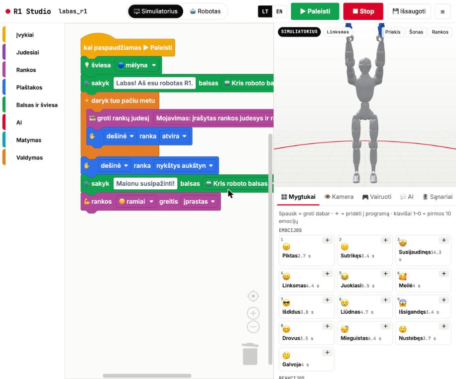
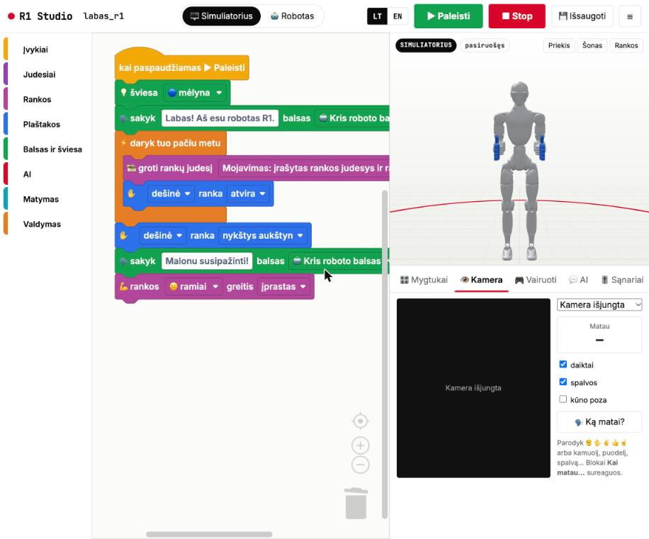
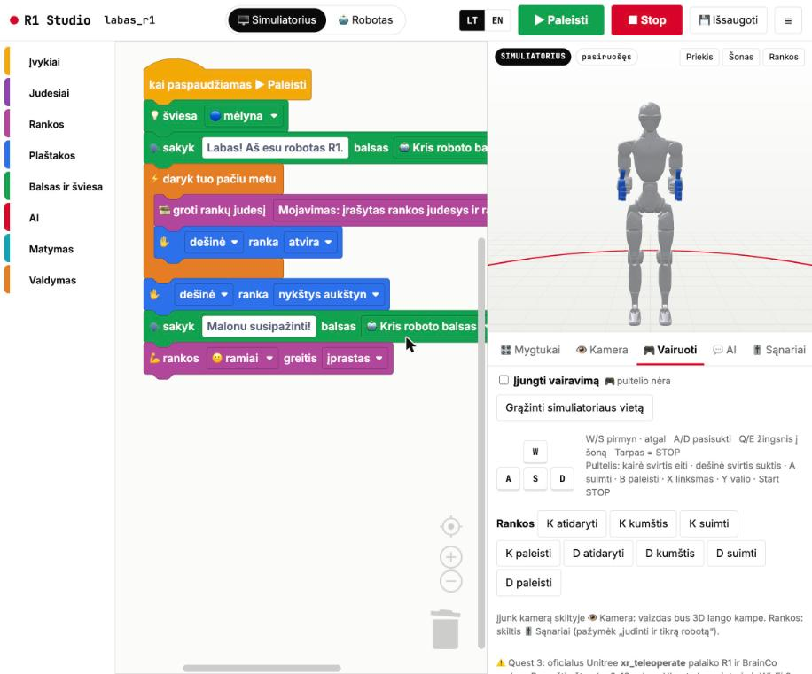
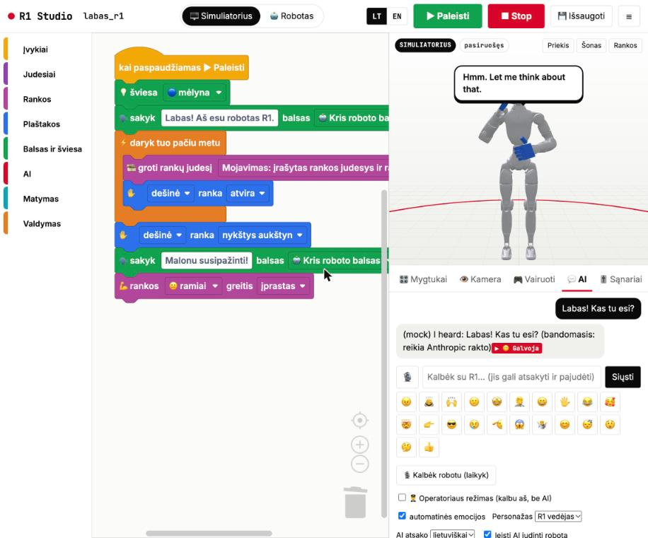
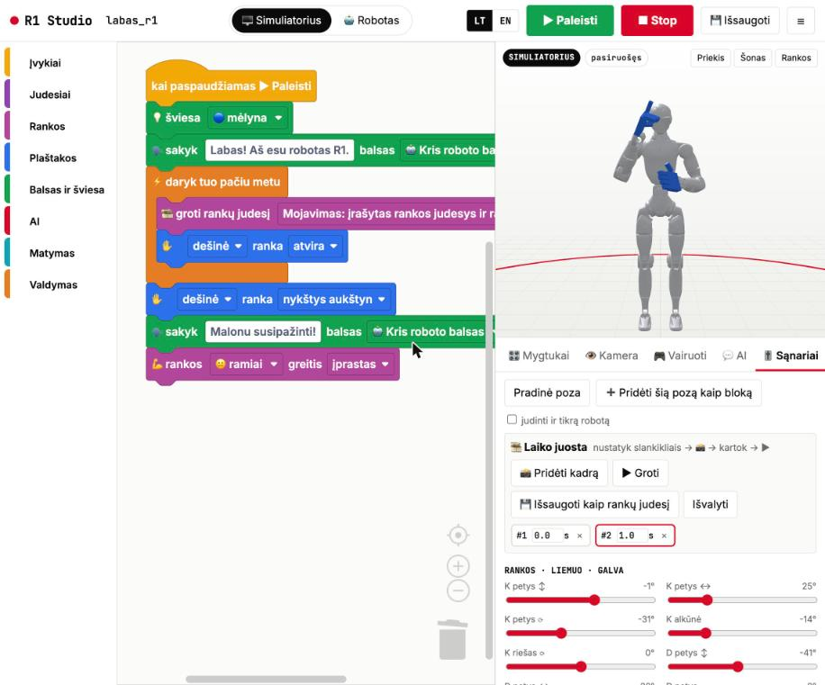
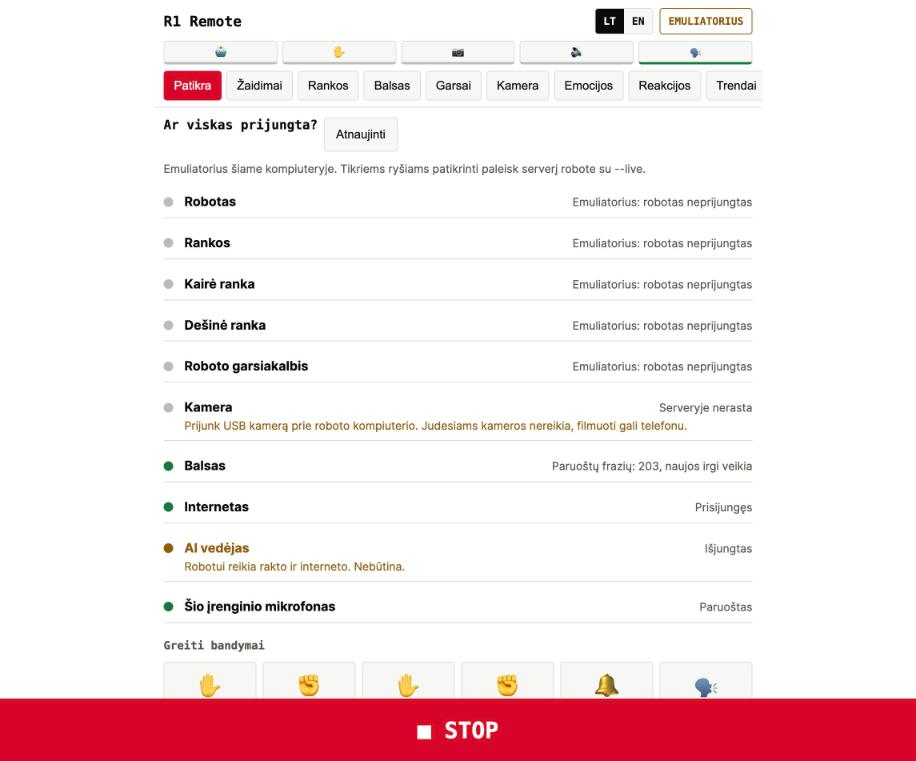
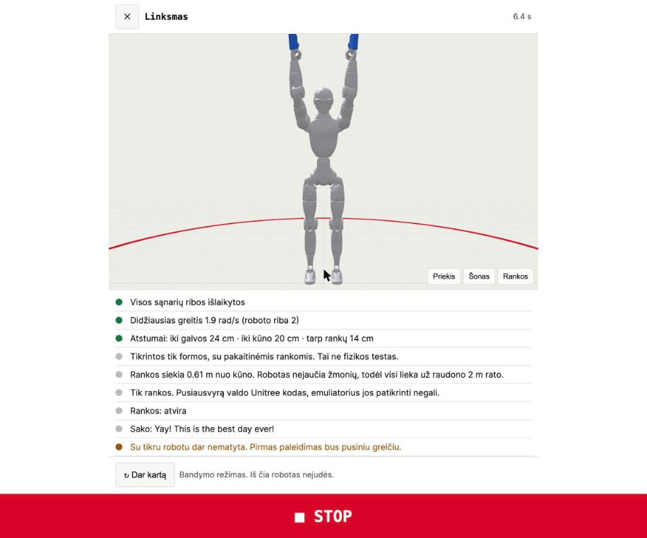

# R1 Studio: pamoka / tutorial

🇱🇹 [Lietuviškai](#lietuviškai) · 🇬🇧 [English](#english)

---

## Lietuviškai

### 1. Kas tai
R1 Studio yra naršyklės programa robotui **Unitree R1 EDU**: programuoti blokais, groti paruoštus judesius, kalbėti per robotą ir jį valdyti.
Ją per maždaug dvi savaites (pirmas įrašas 2026-10-23, šis 2026-11-07) sukūrė Kris Vas, dirbdamas su paskolintu robotu.
Viskas veikia ir be roboto: 3D simuliatorius rodo tą patį judesį, kurį gautų robotas.

### 2. Ką ji moka

**Blokai** (kairėje). Programuoji kaip Scratch ar LEGO SPIKE: įvykiai, judesiai, rankos, plaštakos, balsas ir šviesa, AI, matymas, valdymas. ▶ Paleisti paryškina veikiantį bloką.
**Mygtukai** (🎛️). 45 paruošti judesiai šešiose grupėse (emocijos, reakcijos, trendai, filmai, kovos, daiktai) ir 12 gamyklinių Unitree šokių bei gestų. Spausk ir groja, ＋ prideda į programą, klavišai 1–0 groja emocijas.



**Kamera** (👁️). Kompiuterio arba roboto kamera. Atpažįsta rankų ženklus, daiktus, spalvas ir kūno pozą naršyklėje, be interneto. Blokai „kai matau…“ sureaguoja.



**Vairuoti** (🎮). Klaviatūra (WASD, QE) arba žaidimų pultelis, rankų mygtukai. Simuliatoriuje robotas eina 3D erdvėje.



**AI vedėjas ir roboto balsas** (💬). Kalbiesi su robotu raštu arba balsu. AI atsako lietuviškai arba angliškai ir gali paleisti vieną judesį iš leidžiamų sąrašo. Operatoriaus režime kalbi tu, robotas pakartoja. Mygtukas „Kalbėk robotu“ paverčia tavo balsą roboto balsu. AI veikia tik su Anthropic raktu; nuotraukoje matyti bandomasis režimas be rakto.



**Sąnariai ir laiko juosta** (🎚️). 13 slankiklių rankoms, liemeniui ir galvai, 12 pirštams. Nustatai pozą, 📸 prideda kadrą, ▶ groja, 💾 išsaugo kaip naują rankų judesį.



**Kodas ir žurnalas** (</> 📜). Matai tikslų failą, kurį gauna robotas (`r1ctl` šokis), ir kas įvyko.


**R1 Remote telefonui** (`/phone.html`). Tikram robotui valdyti skirtas tik šis puslapis. Patikra rodo, kas prijungta. Prieš kiekvieną judesį 3D modelyje patikrinamos sąnarių ribos, greitis ir atstumai iki galvos, kūno ir kitos rankos.




**Saugumo modelis.** Taisykles tikrina serveris, ne puslapis:
- Robotas juda tik įrašius **GO**. STOP, pabaiga ir 15 min. be veiksmo judesius išjungia.
- Su robotu dar nematytas judesys paleidžiamas pusiniu greičiu.
- Rankų programa turi griežtą ribą: 2 rad/s bet kuriam sąnariui.
- Paleidžiami tik tie rankų failai, kurie praėjo kūno patikrą Unitree modelyje (`arm_safe.json`: šiandien 59 praėjo, 16 jogos failų ne).
- Pavienės pozos, ėjimas ir AI žingsniai tikram robotui atmetami.
- Tikras avarinis stabdymas yra roboto pultelis (L2 + B, 5 s).

### 3. Paleisti per 2 minutes

**Mac, tik simuliatorius (robotas nejuda):**
```bash
git clone https://github.com/KrisVas333/r1-studio ~/r1 && cd ~/r1/sim
git clone --depth 1 --filter=blob:none --sparse https://github.com/unitreerobotics/unitree_mujoco
(cd unitree_mujoco && git sparse-checkout set unitree_robots/r1)
python3 -m venv .venv && .venv/bin/pip install mujoco pyyaml numpy "imageio[ffmpeg]"
~/r1/sim/.venv/bin/python ~/r1/studio/server.py
```
Atidaryk Chrome: **http://localhost:8080**. Kalba: viršuje dešinėje **LT / EN**.

**Robote** (po `~/r1/deploy.sh`, PC2 kompiuteryje, žr. [R1-SETUP.md](../R1-SETUP.md)):
```bash
ssh unitree@192.168.123.164
python3 ~/r1-kit/studio/server.py --live --pin 4821
```
Telefone ar kompiuteryje atidaryk **http://192.168.123.164:8080/phone.html**.

### 4. Būsena, sąžiningai

| Dalis | Būsena |
|---|---|
| Studija, blokai, mygtukai, 3D simuliatorius | ✅ veikia simuliatoriuje (Chrome, Mac) |
| LT / EN sąsaja | ✅ patikrinta naršyklėje 2026-11-07 |
| Serverio saugos taisyklės (GO, STOP, greitis, patikra) | ✅ 54 automatiniai testai su netikru robotu |
| r1ctl valdiklis | ✅ 30 iš 31 testo; 1 laiko testas kartais nepraeina |
| Mac tiesioginis tiltas (balsas, LED, būsena) | ✅ 20 testų su netikru robotu · ✅ roboto balsas iš Mac veikė (bandomasis skriptas, 2026-11-07) · ⚠️ pats tiltas su tikru robotu dar nepaleistas |
| Kamera, daiktų ir rankų atpažinimas | ✅ veikia su kompiuterio kamera (tikrinta 2026-10-23) |
| Bet kuris judesys tikram robotui | ⚠️ dar nepaleistas |
| BrainCo Revo2 rankos | ⚠️ dar nepatikrintos su šiuo kodu |
| Gamyklinių šokių ir gestų numeriai | ⚠️ paimti iš bendruomenės, nepatvirtinti |
| Roboto galvos kamera | ⚠️ oficialios R1 kameros sąsajos neradome |
| AI vedėjas lietuviškai | ⚠️ veikia kodas, bet be Anthropic rakto netikrinta |
| Judesių ištarti sakiniai | ⚠️ kol kas angliškai |

**Bandymas su tikru robotu, 2026-11-07.** Mac per Ethernet pasiekė roboto judesio kompiuterį **192.168.123.161** (viršutinis dešinysis RJ45 lizdas po kaklu). Galinis EDU skaičiavimo modulis (**192.168.123.164**) neįsijungė: nėra lemputės, neatsako į ping, o pats robotas tinkle klausia, kas yra .164. Todėl rankų ir kitų funkcijų, kurios veikia modulyje, dar išbandyti negalėjome. Apie tai pranešta Unitree palaikymui.

### 5. Kas toliau
1. Įjungti EDU modulį (Unitree palaikymas).
2. Pirmas bandymas ant stovo: vienas rankų judesys pusiniu greičiu ir STOP.
3. Renginių režimas per kišeninį Wi‑Fi maršrutizatorių, su `--pin`.

### 6. Valdymas tiesiai iš Mac (be EDU kompiuterio)

Kai galinis EDU kompiuteris (PC2) išjungtas, Mac gali kalbėtis su robotu pats, per laidą.

**Trys būdai, po vieną komandą:**

| Būdas | Komanda | Kas veikia |
|---|---|---|
| A. Mac + laidas | `~/r1/start-robot.sh mac` | būsena, balsas, LED, garsumas |
| B. EDU kompiuteris (PC2) | `~/r1/start-robot.sh pc2 4821` | viskas: judesiai, rankos, plaštakos |
| C. Renginys (telefonas per Wi‑Fi) | `~/r1/start-robot.sh event 4821` | kaip A, bet iš telefono |

Studijos viršuje matosi, kuris būdas įjungtas: A ir C rodo ženkliuką **🟢 Robotas: prisijungęs** arba **🔴 Robotas: neprisijungęs**. R1 Remote telefone rodo **MAC → ROBOTAS**.

**1. Laidas.** Ethernet laidas į **viršutinį dešinįjį RJ45 lizdą po kaklu**, kitas galas į Mac (USB‑C Ethernet adapteris).

**2. Adresas.** Mac gauna **192.168.123.222**: `~/r1/connect.sh en16` (adapterio vardą parodo `~/r1/connect.sh`). Robotas yra **192.168.123.161**.

**3. Vieną kartą paruošti:** `~/r1/build-cyclonedds.sh` (CycloneDDS 0.10 ir Unitree SDK į `~/r1/.venv-sdk`).

**4. Paleisti.** `~/r1/start-robot.sh mac`. Tiltas `studio/mac_bridge.py` tik skaito. Kad robotas kalbėtų: `~/r1/start-robot.sh mac --allow-commands`, tada programoje įrašyk **GO**. STOP visada išjungia.

**5. Patikrinti:** `curl -s http://127.0.0.1:8090/state` parodo `"connected": true`, režimą, padėtį, greitį ir roboto garsumą.

**Kas veikia:**
- ✅ roboto būsena (judesio režimas, padėtis, greitis, pultelio mygtukai)
- ✅ roboto balsas (Unitree TTS), LED spalva, garsumas
- ✅ Kris balsas (ElevenLabs) skamba kompiuteryje. Ženkliukas: 🔊 = robotas, 💻 = kompiuteris.

**Kas neveikia (dar):**
- ❌ rankos ir plaštakos (veikia tik per PC2)
- ❌ kameros įgūdžiai roboto kompiuteryje
- ❌ rankų judesiai iš Mac: pirmas rankų komandos siuntimas einant užrakina robotą (FSM 816) iki perkrovimo
- ⚠️ Unitree balsas kalba angliškai ir kiniškai. Lietuviškas tekstas skamba netaisyklingai.

**Renginiams be laido (planas, dar nepirkta):** kišeninis kelioninis Wi‑Fi maršrutizatorius su LAN lizdu (pvz. GL.iNet). Laidas iš roboto į maršrutizatorių, maršrutizatorius dalina tą patį **192.168.123.x** tinklą per Wi‑Fi. Mac ir telefonai jungiasi prie jo Wi‑Fi. Iki tol: `start-robot.sh event 4821`, telefonas tame pačiame Wi‑Fi kaip Mac, adresas **http://&lt;Mac adresas&gt;:8080/phone.html**, PIN 4821.

---

## English

### 1. What it is
R1 Studio is a browser app for the **Unitree R1 EDU**: program it with blocks, play ready-made moves, speak through the robot and drive it.
Kris Vas built it in about two weeks (first commit 2026-10-23, this one 2026-11-07) with the loaned robot.
Everything also runs without the robot: a 3D simulator shows the same move the robot would receive.

### 2. What it can do

**Blocks** (left). Scratch / LEGO SPIKE style: events, moves, arms, hands, voice and light, AI, vision, control. ▶ Run highlights the running block.
**Deck** (🎛️). 45 preset moves in six groups (emotions, reactions, viral, movies, fight, objects) plus 12 Unitree factory dances and gestures. Click to play, ＋ adds to the program, keys 1–0 play emotions.
**Camera** (👁️). Computer or robot camera. Hand signs, objects, colours and body pose, recognised in the browser, offline. "When I see…" blocks react.
**Drive** (🎮). Keyboard (WASD, QE) or gamepad, hand buttons. In the simulator the robot walks in 3D.
**AI host and robot voice** (💬). Talk to the robot by text or voice. The AI answers in Lithuanian or English and may run one move from an allowed list. Operator mode: you type, the robot says it. "Talk as robot" turns your voice into the robot voice. The AI needs an Anthropic key; the screenshot shows mock mode without one.
**Joints and timeline** (🎚️). 13 sliders for arms, waist and head, 12 for fingers. Pose, 📸 add a keyframe, ▶ play, 💾 save as a new arm move.
**Code and Log** (</> 📜). The exact file the robot receives (an `r1ctl` dance) and what happened.
**R1 Remote phone page** (`/phone.html`). The only page that drives the real robot. Check shows what is connected. Before any move, the 3D model checks joint limits, speed and the gaps to the head, the body and the other hand.

Screenshots: see the Lithuanian section above (the UI was in LT mode).

**Safety model.** The server enforces the rules, not the page:
- The robot moves only after typing **GO**. STOP, End and 15 idle minutes disarm it.
- A move not yet seen on the real robot runs at half speed.
- The arm program has a hard cap of 2 rad/s on any joint.
- Only arm files that passed the body check on Unitree's model can run (`arm_safe.json`: today 59 pass, 16 yoga files do not).
- Single poses, walking and AI steps are refused on the real robot.
- The real emergency stop is the hardware remote (L2 + B, 5 s).

### 3. Run it in 2 minutes
Mac, simulator only: the five commands in the Lithuanian section, then open **http://localhost:8080**. Language: **LT / EN** top right.
On the robot (after `~/r1/deploy.sh`, on PC2, see [R1-SETUP.md](../R1-SETUP.md)): `ssh unitree@192.168.123.164`, then `python3 ~/r1-kit/studio/server.py --live --pin 4821`, and open **http://192.168.123.164:8080/phone.html**.

### 4. Honest status
Same table as above: ✅ simulator, LT/EN UI, 54 server safety tests with a fake robot, 20 Mac-bridge tests with a fake robot (robot voice from the Mac worked with a test script on 2026-11-07; the bridge itself has not yet run against the robot), 30 of 31 r1ctl tests (one timing test is flaky), camera recognition with a computer webcam (tested 2026-10-23). ⚠️ No move has run on the real robot yet. Revo2 hands, factory move ids and the head camera are unverified. The Lithuanian AI answer is wired but untested without a key. Spoken lines inside moves are still English.

**Real-robot test, 2026-11-07.** The Mac reached the robot's motion computer **192.168.123.161** over Ethernet (upper-right RJ45 below the neck). The rear EDU computing module (**192.168.123.164**) did not power on: no LED, no ping, and the robot itself sends ARP "who-has .164". So the hands and everything that runs on the module could not be tested yet. Reported to Unitree support.

### 5. What's next
1. Power the EDU module (Unitree support).
2. First gantry test: one arm move at half speed, then STOP.
3. Event mode over a pocket Wi‑Fi router, with `--pin`.

### 6. Control straight from the Mac (no EDU computer)

When the rear EDU computer (PC2) is off, the Mac can talk to the robot itself over the cable.

| Way | Command | What works |
|---|---|---|
| A. Mac + cable | `~/r1/start-robot.sh mac` | state, voice, LED, volume |
| B. EDU computer (PC2) | `~/r1/start-robot.sh pc2 4821` | everything: moves, arms, hands |
| C. Event (phone over Wi‑Fi) | `~/r1/start-robot.sh event 4821` | like A, from a phone |

The Studio header shows the mode: A and C show **🟢 Robot: connected** or **🔴 Robot: not connected**; R1 Remote shows **MAC → ROBOT**.

1. **Cable** into the **upper-right RJ45 under the neck**, other end into the Mac (USB‑C Ethernet adapter).
2. **Address:** `~/r1/connect.sh en16` gives the Mac **192.168.123.222** (`~/r1/connect.sh` lists adapter names). The robot is **192.168.123.161**.
3. **One-time setup:** `~/r1/build-cyclonedds.sh` (CycloneDDS 0.10 + Unitree SDK into `~/r1/.venv-sdk`).
4. **Start:** `~/r1/start-robot.sh mac`. The bridge `studio/mac_bridge.py` is read-only. To let the robot speak: `~/r1/start-robot.sh mac --allow-commands`, then type **GO** in the app. STOP always disarms.
5. **Check:** `curl -s http://127.0.0.1:8090/state` shows `"connected": true`, mode, position, velocity and robot volume.

Works: ✅ robot state (motion mode, position, velocity, remote buttons) · ✅ robot voice (Unitree TTS), LED colour, volume · ✅ Kris voice (ElevenLabs) on the computer; chip 🔊 = robot, 💻 = computer.
Not yet: ❌ arms and hands (PC2 only) · ❌ camera skills on the robot computer · ❌ arm moves from the Mac: the first arm command while walking locks the robot (FSM 816) until reboot · ⚠️ Unitree's voice speaks English and Chinese; Lithuanian text sounds wrong.

**Events without the cable (plan, not bought yet):** a pocket travel router with a LAN port (e.g. GL.iNet). Robot cable into the router; the router shares the same **192.168.123.x** network over Wi‑Fi, and the Mac and phones join it. Until then: `start-robot.sh event 4821`, phone on the same Wi‑Fi as the Mac, open **http://&lt;Mac address&gt;:8080/phone.html**, PIN 4821.

---
Known gaps and details: [studio/README.md](../studio/README.md). Licences: [THIRD_PARTY_NOTICES.md](../THIRD_PARTY_NOTICES.md). Help us: [CONTRIBUTING.md](../CONTRIBUTING.md).
